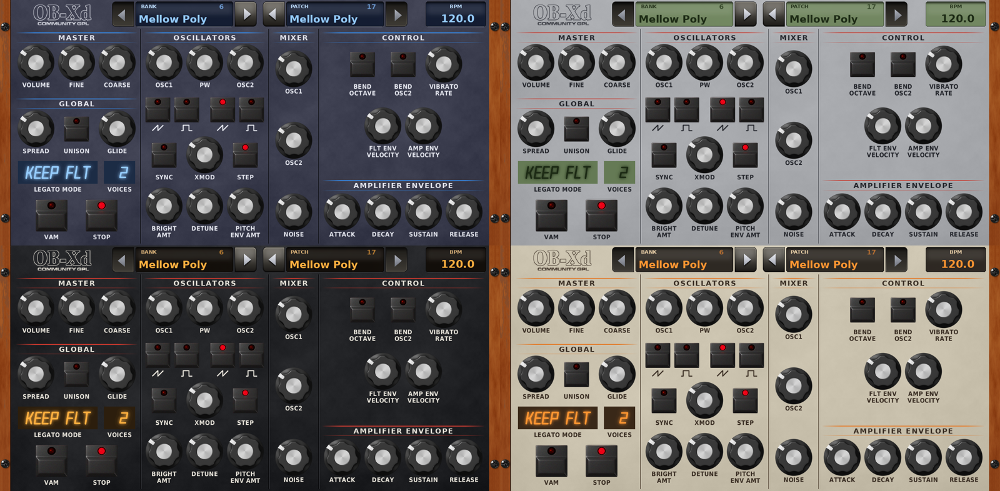
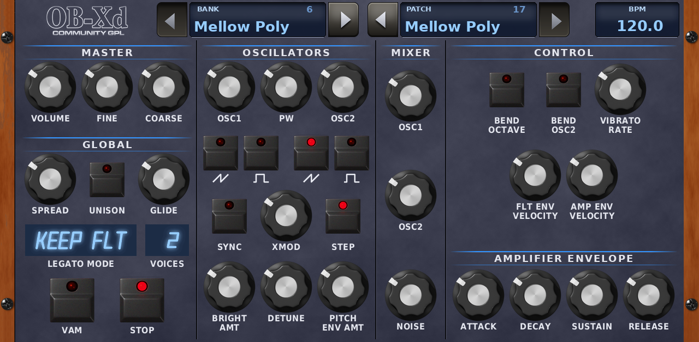
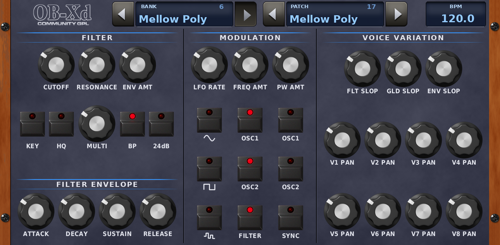
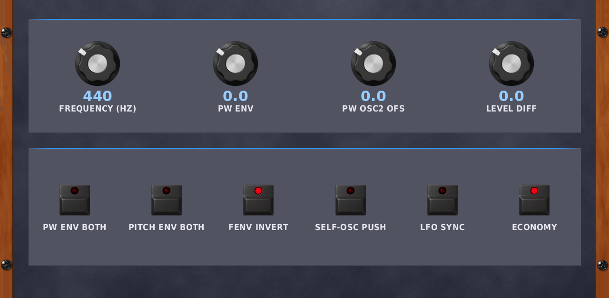

# OB-Xd for MPC OS (unofficial port)

A native ARM VST2 build of the OB-Xd synthesizer for first-generation Akai MPC / Force standalone units
(developed and tested on an MPC Live II, MPC OS 3.x). Built with [sd88me/mpc-vst-plugins](https://github.com/sd88me/mpc-vst-plugins) (MIT).

**Unofficial:** not affiliated with or endorsed by discoDSP, 2Dat, Akai or the community OB-Xd project. See [CREDITS.md](CREDITS.md).

## What you get

- All 77 OB-Xd parameters, 8 voices, on a full-screen touch panel in the community theme's style, split over three pages with big
  knobs and buttons for fingers (tabs at the top): **OSC** (master, global, oscillators, mixer, control, amp envelope), **FILTER**
  (filter, filter envelope, modulation, voice variation) and **MORE** for the controls the panel has no place for.
  BANK, PATCH and BPM are on the OSC and FILTER pages.
- **THEME** (bottom of the MORE page, also the last MORE Q-Link): four looks, switched live. **Slate** (default), **MPC Grey** (classic MPC grey with
  green LCD displays), **MPC Black** (MPC1000-style black with amber displays) and **Retro** (cream with orange LED displays). The BANK / PATCH / BPM
  displays, legato and voices readouts change colour with it.  Saved as a normal parameter at the end of the list,
  so older projects load unchanged.
- **FREQUENCY (Hz):** reference pitch, 400 to 480 Hz (default 440), on the MORE page. It sits on top of TUNE and is not stored in presets.
- **STOP:** a panic button (all notes and sound off) next to VAM. LEARN, CLEAR and MENU are removed (no MIDI learn on the MPC).
- **BANK / PATCH selector** at the top centre of the OSC and FILTER pages, each with a left and a right arrow (right = next, left = previous, they wrap around). Banks are plain OB-Xd `.fxb` files in the `banks` folder next to the plugin; the release ships the Moby Pixel bank and three banks of CC0 (public domain) patches. Your own banks go in a `my-banks` folder next to `banks`; `banks` itself is replaced on every install, so it only ever holds what the release ships.
  Names longer than 16 characters end in `..` so they stay inside the display. The MPC PRESET menu lists the patches of the current bank.
- **Tempo sync for arps and sequences:** OB-Xd has no arpeggiator or sequencer of its own; those patches use the LFO. Turn on **SYNC**
  (under MODULATION on the FILTER page, also on the MORE page) and the LFO follows the MPC tempo, which the **BPM** display in the top right corner shows: the LFO RATE knob then picks how many cycles per beat (1/8, 1/4, 1/3, 1/2, 1, 3/2, 2, 3 or
  4), and it restarts when you press play. Loading a patch sets LFO SYNC to what the patch stores, which for the stock banks is off.
- **Q-Links** come in pages of four, matching the MPC's four knobs, in panel order. OSC page: OSC (oscillators; tone; mixer + volume; amp envelope)
  and MASTER (volume, tune, octave, glide; spread, filter and amp velocity, bend range). FILTER page: FILTER (filter; filter envelope; LFO; slop)
  and VOICES (pan 1-4, pan 5-8). MORE page: its own controls, then THEME.

Engine: OB-Xd **2.10** source (the DSP of the community GPL fork). discoDSP's later releases (2.11 to 2.20) are binary-only, so
their changes are not in here.

## Install

Use a release zip: unpack it and follow `INSTALL.md` inside (run `install.sh` on the device as root, or copy the `portable/` folder into a
Synths folder on the internal drive). Back up `MPC.settings` first. External drives are mounted noexec, so install to the internal drive.

## Build it yourself

Ubuntu or WSL2 (Docker with QEMU for arm32v7; run it in the Linux home folder, not on a Windows drive):

    git clone https://github.com/sd88me/mpc-vst-plugins ../mpc-vst-plugins
    git clone <this repo> mpc-vst-obxd && cd mpc-vst-obxd
    ./build.sh                    # writes vst/build/ (obxd.so, skin/, pluginlist-entry.xml)
    ../mpc-vst-plugins/tools/test_port.sh vst/vst.json     # offline x86 test, must print PASSED

The skin is already generated and committed, so there is nothing else to run. Packaging and catalog listing: `docs/RELEASING.md`.

## Regenerating the skin (optional)

    python3 tools/make_skin.py skin-source/"Default Skin"             # Pillow needed: sudo apt install python3-pil

You can point it at a theme from your own OB-Xd install. That is for your own device: those files are not ours to redistribute, so keep the
output out of public releases.

## More banks (optional, for your own device)

The release ships the Moby Pixel bank (GPL) and three banks of CC0 patches converted from OB-Xf's factory set (79 patches, credits in `banks/CREDITS-CC0.md`). OB-Xd's own factory banks belong to discoDSP and their authors, so they are not included. If you
have OB-Xd installed (it is free from discoDSP), copy its `.fxb` files into a `my-banks` folder next to the plugin's `banks` folder on the MPC (create it; the plugin reads both):

    /sdcard/Synths/sd88me - VST - OB-Xd/my-banks/

Re-open the plugin and they show up in BANK, in file-name order. Patches still called "Default" or "Init" are hidden. The installer keeps
that folder when you upgrade. Do not publish those files or a zip that contains them (`tools/make_releases.sh` can build such a zip for
your own device, in `dist-private/`).

## Licence

Code: GPL v3 (see `LICENSE`). Anyone you give a built plugin to is entitled to this source, so link to this repository wherever you share
binaries. The skin artwork (`skin-source/`, `vst/images/`) is gitterdude's community theme under CC BY-SA 3.0, see `skin-source/NOTICE.md`.
The Moby bank (`banks/`) is from the GPL community repository, see `banks/NOTICE.md`; the CC0 banks are credited in `banks/CREDITS-CC0.md`. Everything else, with who wrote it: [CREDITS.md](CREDITS.md).
